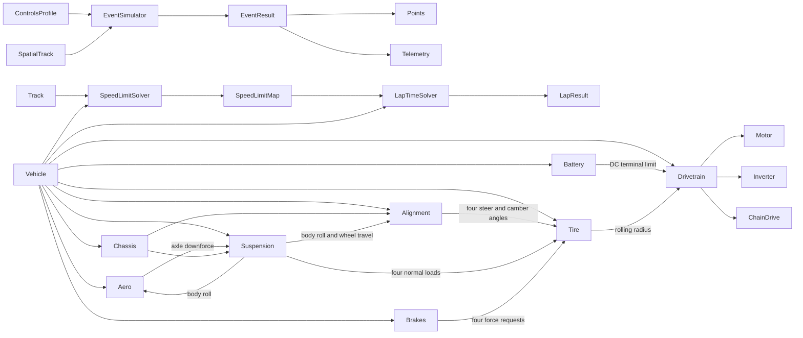

# Simulator architecture

The code is split into two packages with different responsibilities:

- `lapsim` owns event APIs, tracks, controls, solvers, optimization, replay,
  and plotting.
- `vehicle_model` owns physical parameters, component state, and force/power
  calculations.

The lap solvers depend on component interfaces rather than a specific motor,
tire, or suspension implementation.

Analysis code enters through the points-producing event facade:
`simulate_endurance`, `simulate_acceleration`, or `simulate_skidpad`. Each
accepts a `Vehicle`, `SpatialTrack`, and `ControlsProfile` and returns the same
`EventResult` with timing, energy, estimated points, completion status, and
aligned component telemetry. The older limit and replay solvers remain
lower-level physics tools rather than separate analysis contracts.



`Vehicle` is a coordinator. It does not own motor curves, aero coefficients,
or suspension parameters. Each component owns and validates its own
configuration and dynamic state. It binds the drivetrain's tire dependency to
the same `TireModel` instance owned by the vehicle, so rolling-radius geometry
has one source of truth.

`vehicle.py` stays at the top of `vehicle_model` because it coordinates every
domain. Implementations are grouped by the subteam that owns their physics:

| Subteam package | Ownership |
|---|---|
| `vehicle_model.electrical` | accumulator, OCV data, inverter |
| `vehicle_model.aero` | aerodynamic coefficients and forces |
| `vehicle_model.powertrain` | motor, chain drive, drivetrain coordination |
| `vehicle_model.mech` | chassis, suspension, tires, brakes, tire loads |

`interfaces.py` and `environment.py` remain at the top because they are shared
across subteams. `vehicle_model.__init__` re-exports the main classes, while
the subteam packages provide explicit ownership-oriented imports.

## Inside the vehicle subsystems

[Reading and changing the vehicle model](vehicle_model.md) maps every physical
responsibility to its implementation module and explains the sign conventions.
The top-level coordinator passes named results between distinct stages:
`ForceRequests` -> `OperatingPoint` -> `MotionStep` / `PowerFlow` -> committed
component and vehicle state.

`dynamics.py` owns the coupled force solve, `motion.py` owns motion integration,
and `limits.py` owns the spatial braking envelope. Within each subsystem:

- Aero separates passive forces, active deployment, shared results, and setup
  defaults.
- Electrical separates ideal sources, pack history, and instantaneous terminal
  circuit math. OCV and RC models share the same circuit implementation.
- Powertrain owns propulsion conversion, rotational inertia, regeneration, and
  wheel-to-pack power accounting. Motor, inverter, and chain models keep their
  own physical conversion laws.
- Mechanical separates tire laws from contact-force allocation and wheel state,
  suspension state from load-transfer calculations, alignment from measured
  camber curves, and brake state from hydraulic calibration.

Compatibility import modules retain established paths. Component protocols,
vehicle construction, mutable setup fields, and telemetry channels remain the
public contracts.

## Time-domain vehicle integration

The spatial lap solvers query limits such as maximum tire force, maximum motor
torque, and braking deceleration. These calculations should be deterministic
for a given operating point; the solvers do not rely on a previous timestep's
mutable state.

Simulation and recorded-control replay call
`Vehicle.update_state(controls, timestep_s)`. Time is the independent
integration coordinate. Steering sets Ackermann front-wheel angles. Candidate
body sideslip and yaw rate create a distinct local velocity and slip angle at
every contact patch. The vehicle solves acceleration, body sideslip, and
curvature against longitudinal force, lateral force, and steady yaw-moment
balance; curvature is therefore an outcome of the tire forces. It then solves
final speed and traveled distance
and updates every component with the same supplied time step. Call
`Vehicle.reset_state()` before each independent run.

See [How `Vehicle.update_state` works](update_state.md) for the full solve and
integration flowcharts, equations, and component update order.

Spatial event solvers use an adapter that solves the time step needed to land
on the next track-cell boundary before committing a time-domain vehicle update.
Temperature, state of charge, slip relaxation, and other history-dependent
behavior therefore evolve directly in seconds.

## Component ownership

| Component | Owns now | Natural future additions |
|---|---|---|
| `RCTheveninBattery` | OCV, SOC, current, ohmic drop, one-RC polarization, power limits | temperature, second RC branch, aging |
| `Inverter` | DC-to-motor efficiency | efficiency map, current/voltage limits, thermal state |
| `Motor` | peak/continuous torque curves, power limits, RPM limit, efficiency, rotor inertia | efficiency map, voltage dependence, thermal derating |
| `ChainDrive` | sprocket ratio, efficiency, input/output inertia | chain loss map, compliance, sprocket selection |
| `Drivetrain` and powertrain power flow | component coordination, driven-wheel inertia, propulsion and regen accounting | coupled electrical limits, efficiency maps |
| `Aero` / `ActiveAero` | frontal area, drag/lift coefficients, aero balance, linear body-roll downforce loss, switchable straight-line low-drag configuration | ride-height/yaw maps, actuator dynamics, center of pressure |
| `Chassis` | wheelbase, track widths, CG height, static weight distribution | roll centers, sprung/unsprung masses |
| `Suspension` | longitudinal transfer, quasi-static lateral transfer, roll stiffness and TLLTD | geometric transfer, springs, dampers, heave/pitch |
| `WheelAlignment` | anti-Ackermann, toe, static camber, caster camber, and camber gain | measured steering-linkage and suspension-kinematics maps |
| `Tire` | rolling radius, four-corner kinematics and wheel state, Pacejka lateral force, combined force capacity, longitudinal slip/relaxation | loaded-radius model, full combined-slip curve, temperature, wear |
| `Brakes` and hydraulic maps | brake setup/state, hydraulic calibration, and brake-force requests | thermal limits, ABS control |

The battery boundary is the DC pack terminal. The default one-RC pack model
computes OCV, ohmic drop, and polarization before that boundary; propulsion
conversion losses then continue through the inverter, motor, and chain drive.
The static `OCVPackBattery` and constant-power `Battery` models remain
available for comparisons.

## Telemetry ownership

Telemetry is schema-free and component-owned. Every component implements
`update_telemetry(telemetry: dict[str, float])` and writes its current scalar
signals under a namespaced key such as `motor.speed_rpm` or
`battery.terminal_voltage_v`. `Vehicle.telemetry_snapshot()` calls the vehicle
and every nested component writer to create one complete dictionary.

`TelemetryRecorder` accumulates snapshots into equal-length channel histories.
A component may add or omit optional signals without changing a central
telemetry dataclass; the recorder backfills unavailable samples with `NaN`.
The final `Telemetry` object implements `Mapping`, so channels can be accessed
with `telemetry["limits.traction_active"]` or exported with
`telemetry.as_dict()`.

## Shared data contracts

Components exchange small immutable result objects rather than reaching into
one another's implementation:

- `AeroForces` carries drag and front/rear downforce.
- `TireNormalLoads` carries all four normal loads.
- `WheelAlignmentState` carries each wheel's steering angle, camber, and bump/droop travel.
- `TireStates` carries every contact patch's steering angle, local velocity,
  wheel speed, wheel/body-frame forces, capacities, and slip.
- `Controls` carries driver or optimizer requests.

Keep new result objects in similarly focused modules. This prevents a solver
from becoming coupled to the fields of one detailed model.

## Source layout

```text
src/
|-- lapsim/
|   |-- __init__.py             # stable public facade
|   |-- core/                   # controls, profiles, telemetry
|   |-- courses/                # geometry and spatial tracks
|   |-- events/                 # accel, skidpad, endurance, scoring
|   |-- solvers/                # physical limits and lap-time tools
|   |-- optimization/           # endurance profile optimization
|   `-- data/                   # recorded-lap adapters and replay
|-- vehicle_model/
|   |-- interfaces.py
|   |-- vehicle.py              # assembly and public state
|   |-- dynamics.py             # coupled force balance
|   |-- motion.py               # motion integration
|   |-- limits.py               # whole-vehicle braking envelope
|   |-- environment.py
|   |-- electrical/
|   |   |-- battery.py          # compatibility imports
|   |   |-- battery_ideal.py
|   |   |-- battery_pack.py     # OCV and RC history
|   |   |-- battery_circuit.py  # shared terminal equations
|   |   |-- battery_parameters.py
|   |   |-- battery_ocv.py
|   |   `-- inverter.py
|   |-- aero/
|   |   |-- model.py            # compatibility imports
|   |   |-- passive.py
|   |   |-- active.py
|   |   |-- forces.py
|   |   `-- parameters.py
|   |-- powertrain/
|   |   |-- drivetrain.py
|   |   |-- motor.py
|   |   |-- power_flow.py
|   |   `-- chain_drive.py
|   `-- mech/
|       |-- chassis.py
|       |-- alignment.py
|       |-- camber_gain.py
|       |-- suspension.py
|       |-- load_transfer.py
|       |-- tire.py
|       |-- tire_forces.py
|       |-- wheel_state.py
|       |-- wheels.py
|       |-- pacejka*.py
|       |-- brakes.py
|       |-- brake_hydraulics.py
|       `-- loads.py
`-- utils/
    `-- units.py
```
