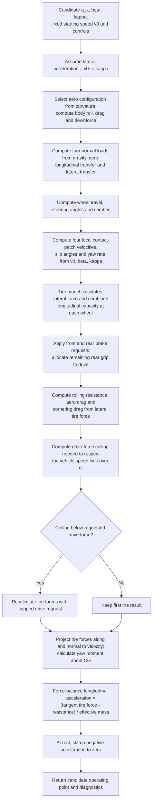

# How `Vehicle.update_state` works

`Vehicle.update_state(controls, timestep_s)` advances one vehicle by one time
interval. It solves a force-balanced operating point using the **speed at the
start of the interval**, integrates motion, then updates component and vehicle
state. It returns `None`; the result is the mutated `Vehicle` and its
components. The coordinator is in
[`vehicle.py`](../src/vehicle_model/vehicle.py); the force solver is in
[`dynamics.py`](../src/vehicle_model/dynamics.py), motion integration in
[`motion.py`](../src/vehicle_model/motion.py), and energy accounting in
[`powertrain/power_flow.py`](../src/vehicle_model/powertrain/power_flow.py).
See [the vehicle model guide](vehicle_model.md) for subsystem responsibilities.

The inputs are a [`Controls`](../src/lapsim/core/controls.py) value containing
motor torque, front and rear hydraulic pressure, rear regenerative brake force,
and steering angle, plus a time step in seconds. `controls` must be a `Controls`
instance; the time step must be finite and positive; and the vehicle's starting
speed must be nonnegative. A caller can use `reset_state()` before an independent
run. Replay calls `update_state` once per control sample; spatial event solvers
use [`advance_vehicle_by_distance`](../src/lapsim/core/integration.py) to find a
time step for each track cell.

## Whole-step flowchart

```mermaid
flowchart TD
    A["update_state(controls, dt)"] --> B{"Valid Controls, finite positive dt,<br/>nonnegative starting speed?"}
    B -- No --> E["Raise TypeError, ValueError, or RuntimeError"]
    B -- Yes --> C["Read starting speed and wheel positions"]
    C --> D["Limit requested motor torque by available torque<br/>at starting speed and battery state"]
    D --> F["Convert motor torque to requested rear drive force;<br/>convert front and rear brake pressures to force;<br/>add rear regen force request"]
    F --> G{"Steering effectively zero<br/>or starting speed at most 1e-6 m/s?"}
    G -- Yes --> H["Solve longitudinal acceleration with brentq;<br/>set body slip and curvature to zero"]
    G -- No --> I["Seed body slip and curvature from prior state<br/>or steering geometry; clamp seeds to bounds"]
    I --> J["Solve acceleration, body slip, curvature<br/>with bounded least_squares"]
    J --> K{"Solver reports success?"}
    K -- No --> L["Raise RuntimeError with solver state and residuals"]
    K -- Yes --> M["Evaluate ForceBalanceSolver.evaluate at solved values"]
    H --> N["Use solved operating point"]
    M --> N
    N --> O["Predict end speed from solved acceleration and dt"]
    O --> P{"Would end speed be negative?"}
    P -- Yes --> Q["Stop at zero; integrate distance only until stopping time"]
    P -- No --> R["Cap end speed at drivetrain limit;<br/>trapezoidal distance over full dt"]
    Q --> S["Separate actual tire braking into regen and friction;<br/>retain force and resistance diagnostics"]
    R --> S
    S --> T["Update aero with starting speed and solved roll"]
    T --> U{"Effective curvature magnitude<br/>above 1e-12?"}
    U -- Yes --> V["Integrate x and y along a circular arc"]
    U -- No --> W["Integrate x and y along a straight course"]
    V --> X["Compute average speed, driven tire surface speed,<br/>actual motor torque and RPM"]
    W --> X
    X --> Y["Compute propulsion and recovered regen power;<br/>net battery power = propulsion - regen"]
    Y --> Z["Update battery, drivetrain, brakes,<br/>suspension, alignment, tire"]
    Z --> AA["Commit time, distance, speed, heading,<br/>accelerations, curvature, slip, yaw and diagnostics"]
    AA --> AB["Return None"]
```



`ForceBalanceSolver.evaluate` is evaluated many times by either solver. It calculates a
candidate operating point; only after the solve does the method integrate the
vehicle and call the component `update_state` methods.

## What happens inside each force evaluation

The solver's unknowns are assumed longitudinal acceleration `a_x`, body slip
angle `beta`, and path curvature `kappa` (in `1/m`). Steering is an input. The
resulting curvature comes from the tire force and yaw balance, rather than being
assigned directly from steering geometry.



The tire calculation uses the previous tire state and `dt` for longitudinal
slip response, but does not commit its new state until the final tire update.
The effective longitudinal mass is the vehicle mass plus the drivetrain's
wheel-referenced rotating inertia divided by tire rolling radius squared.
Lateral acceleration uses vehicle mass alone. The speed limit comes from the
lower of the configured cap, if any, and the motor RPM limit.

There are three force-balance conditions:

| Condition | Residual driven toward zero |
|---|---|
| Longitudinal | `assumed a_x - force-balance a_x` |
| Lateral, while moving | `normal tire force / mass - v0² × kappa` |
| Steady yaw, while moving | `yaw moment / (mass × wheelbase)` |

For effectively zero steering **or** `v0 <= 1e-6 m/s`, `brentq` solves only
the longitudinal condition with `beta = kappa = 0`, over the acceleration range
`[-100, 100] m/s²`. At moving, nonzero steering, `least_squares` solves all
three conditions with bounds of `±100 m/s²`, `±0.8 rad` body slip, and `±1 1/m`
curvature. Its initial acceleration is zero; the body slip and curvature seeds
come from the last stored values when nonzero, otherwise from steering geometry.
The one-dimensional branch does not enforce lateral or yaw balance, even if a
steering request is present at very low speed.
An unsuccessful `least_squares` result raises `RuntimeError` before motion is
integrated. The `brentq` path also raises if its root cannot be bracketed.

## Integration and state changes

The solved acceleration is treated as constant during the step:

```text
unconstrained_end_speed = v0 + a_x × dt
if unconstrained_end_speed >= 0:
    end_speed = min(unconstrained_end_speed, drivetrain_speed_limit)
    distance_step = (v0 + end_speed) × dt / 2
else:
    stopping_time = -v0 / a_x
    end_speed = 0
    distance_step = v0 × stopping_time / 2
```

Thus a braking step may consume all of `dt` while moving only until it stops.
After distance is known, the method computes effective curvature as solved
lateral acceleration divided by `v0²` when `v0 > 1e-6 m/s`, or zero otherwise.
Heading changes by `curvature × distance_step`. Position follows the course
angle (`heading + body slip`) along an exact constant-curvature arc, with a
straight-line formula near zero curvature. The stored yaw rate is
`v0 × effective curvature`.

The applied tire forces determine energy accounting. Rear regenerative braking
is the smaller of the requested regen force and actual rear braking force; any
remaining actual braking force is counted as friction. Average vehicle speed is
`distance_step / dt`. The driven tire surface speed is that average multiplied
by `1 + driven_slip_ratio`. The method uses this surface speed and actual drive
force for motor RPM and propulsion battery power. Recovered battery power uses
actual rear regen force, the same surface speed, conversion efficiency, and the
battery's charge power limit. The battery receives propulsion power minus
recovered power, so a negative net value charges it.

The component update order is aero, then battery, drivetrain (including motor
and inverter), brakes, suspension, alignment, and tire. Finally the vehicle
stores elapsed time, distance, end speed, heading, acceleration, lateral state,
controls, applied forces, capacities, resistance, and regen power. A later
`telemetry_snapshot()` reads this retained state; `update_state` does not itself
record a telemetry sample.

### Details that matter when reading results

- Available motor torque limits the command before the force solve. Tire grip,
  braking, and the speed limiter may reduce the **actual** drive force further.
  `envelope_limited_motor_torque_nm` records the torque after the initial
  motor/battery limit; drivetrain state uses torque inferred from actual force.
- Brake pressures first become axle force requests. The tire model shares each
  axle request between its two wheels and limits delivered force using combined
  tire capacity. Requested and applied braking therefore need not match.
- `current_*` force and acceleration diagnostics describe the solved operating
  point at the **start** of the interval, while `speed_mps`, `heading_rad`,
  `x_m`, and `y_m` describe the integrated end state.
- The force evaluator may choose an active aero configuration while trying
  candidate curvatures. Dynamic component updates occur after the final
  operating point is chosen; the method is not an atomic rollback operation if
  a later component update raises.
