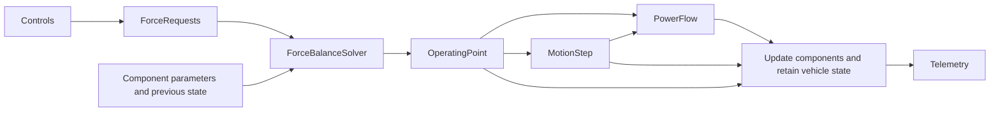

# Reading and changing the vehicle model

Start with [`Vehicle.update_state`](../src/vehicle_model/vehicle.py). It reads
driver requests, solves the forces at the starting speed, integrates the
resulting motion, accounts for power, and commits component state. Each stage
passes a named result to the next stage.



`Vehicle` owns vehicle mass, the environment, initial conditions, position,
speed, and retained force diagnostics. Subsystems own their physical parameters
and history. A component calculation returns a candidate result; its
`update_state` method commits the result for the supplied time interval.

## Where to find each responsibility

Paths below are relative to `src/vehicle_model`.

| Concern | Module | Responsibility |
|---|---|---|
| Vehicle assembly and state | [`vehicle.py`](../src/vehicle_model/vehicle.py) | Validate components, coordinate a step, reset state, collect telemetry |
| Coupled force balance | [`dynamics.py`](../src/vehicle_model/dynamics.py) | Convert controls to axle requests; solve acceleration, body slip, and curvature |
| Motion | [`motion.py`](../src/vehicle_model/motion.py) | Integrate speed, stopping distance, heading, and the ground path |
| Spatial braking envelope | [`limits.py`](../src/vehicle_model/limits.py) | Combine aero, load transfer, and tire grip into maximum deceleration |
| Drivetrain | [`powertrain/drivetrain.py`](../src/vehicle_model/powertrain/drivetrain.py) | Coordinate motor, inverter, chain reduction, rotating inertia, and propulsion limits |
| Power and regeneration | [`powertrain/power_flow.py`](../src/vehicle_model/powertrain/power_flow.py) | Account for achieved wheel forces, slip, propulsion power, and recovered pack power |
| Motor | [`powertrain/motor.py`](../src/vehicle_model/powertrain/motor.py) | Torque curves, shaft power, rotor inertia, and motor conversion losses |
| Chain drive | [`powertrain/chain_drive.py`](../src/vehicle_model/powertrain/chain_drive.py) | Ratio, efficiency, and torque/power conversion across the reduction |
| Inverter | [`electrical/inverter.py`](../src/vehicle_model/electrical/inverter.py) | Convert between pack DC and motor electrical power |
| Ideal battery | [`electrical/battery_ideal.py`](../src/vehicle_model/electrical/battery_ideal.py) | Constant power limits without voltage or SOC history |
| Pack battery | [`electrical/battery_pack.py`](../src/vehicle_model/electrical/battery_pack.py) | OCV lookup, SOC, pack scaling, and optional RC polarization history |
| Battery circuit | [`electrical/battery_circuit.py`](../src/vehicle_model/electrical/battery_circuit.py) | Instantaneous terminal-current solution and voltage-limited power |
| Battery calibration | [`electrical/battery_parameters.py`](../src/vehicle_model/electrical/battery_parameters.py) | Cell/pack defaults; OCV samples remain in `battery_ocv.py` |
| Passive aero | [`aero/passive.py`](../src/vehicle_model/aero/passive.py) | Speed-squared drag and downforce, axle balance, and body-roll loss |
| Active aero | [`aero/active.py`](../src/vehicle_model/aero/active.py) | Select automatic or forced deployment and apply its coefficient multipliers |
| Aero results and setup | [`aero/forces.py`](../src/vehicle_model/aero/forces.py), [`aero/parameters.py`](../src/vehicle_model/aero/parameters.py) | Shared force result and reference-area/calibration defaults |
| Chassis | [`mech/chassis.py`](../src/vehicle_model/mech/chassis.py) | Geometry, CG, roll-axis heights, static weight split, and wheel positions |
| Suspension state | [`mech/suspension.py`](../src/vehicle_model/mech/suspension.py) | Roll stiffness, transfer distribution, and committed loads/roll diagnostics |
| Load-transfer calculation | [`mech/load_transfer.py`](../src/vehicle_model/mech/load_transfer.py) | Static/aero axle loads, pitch transfer, geometric/elastic roll transfer, and wheel lift |
| Wheel alignment | [`mech/alignment.py`](../src/vehicle_model/mech/alignment.py) | Steering geometry, toe, caster, static camber, and roll/travel contributions |
| Camber measurements | [`mech/camber_gain.py`](../src/vehicle_model/mech/camber_gain.py) | Measured camber-versus-travel curves and interpolation |
| Tire grip laws | [`mech/tire.py`](../src/vehicle_model/mech/tire.py) | Tire setup and history; load/camber-sensitive grip and combined-force capacity |
| Contact-force calculation | [`mech/tire_forces.py`](../src/vehicle_model/mech/tire_forces.py) | Allocate brake/drive forces, apply slip relaxation, and resolve forces into body coordinates |
| Wheel kinematics and results | [`mech/wheel_state.py`](../src/vehicle_model/mech/wheel_state.py) | Local contact velocities, slip angles, per-wheel forces, and four-wheel totals |
| Tire coefficients | `mech/pacejka61.py`, `mech/pacejka52_lateral.py`, `mech/pacejka52_longitudinal.py` | Each coefficient set stays beside its force equation |
| Brake state and setup | [`mech/brakes.py`](../src/vehicle_model/mech/brakes.py) | Hardware gains, requested/achieved axle forces, and brake telemetry |
| Hydraulic calibration | [`mech/brake_hydraulics.py`](../src/vehicle_model/mech/brake_hydraulics.py) | Pressure maps, pressure caps/deadband, force-request cap, and inverse maps |

`electrical/battery.py`, `aero/model.py`, and `mech/pacejka.py` keep established
imports working. Their implementation modules are listed above. Existing
imports of wheel result types from `mech/tire.py` and camber curves from
`mech/alignment.py` also remain usable.

## Reading one time step

1. `ForceRequests.from_controls` applies the motor/battery envelope, converts
   torque to rear drive force, converts hydraulic pressures to axle forces,
   and adds the rear regen request. These are requests before tire grip.
2. `ForceBalanceSolver.solve` repeatedly evaluates candidate acceleration,
   body slip, and curvature. Each evaluation calculates aero, load transfer,
   alignment, local wheel velocities, tire forces, resistance, and the drive
   force needed to respect the speed limit. Straight motion uses one scalar
   root; cornering also balances lateral acceleration and steady yaw moment.
3. `integrate_motion` uses achieved acceleration to calculate end speed,
   distance, and pose changes. If braking stops the car during the interval,
   distance accumulates only until the stop.
4. `PowerFlow.calculate` uses achieved tire forces and average driven-wheel
   surface speed to calculate shaft torque/RPM and pack power. Slip changes
   surface speed; recovered power is limited by pack charge capability.
5. `Vehicle` updates aero, battery, drivetrain, brakes, suspension, alignment,
   and tires in the established order, then retains motion and diagnostics.
   Every dynamic component receives the same full time interval.

See [the detailed step equations](update_state.md) for the numerical bounds,
integration equations, and component update order.

## State and sign conventions

| Value | Convention |
|---|---|
| Units | SI in equations; `_psi`, `_rpm`, `_deg`, and other suffixes identify explicit exceptions |
| Four-wheel ordering | Front-left, front-right, rear-left, rear-right (`mech/wheels.py`) |
| Body axes | x forward, y left; positive yaw and curvature turn left |
| Lateral load transfer | Positive lateral acceleration loads the right-side tires |
| Suspension travel | Positive bump, negative droop |
| Vehicle-local camber | Negative means the tire top leans inward, on either side |
| Raw Pacejka inclination | Opposite sign from vehicle-local camber; `Tire` performs the conversion |
| Drive/brake requests | Nonnegative magnitudes; signed longitudinal tire force is drive minus braking |
| Pack current and net power | Positive discharge, negative charge |

Candidate force calculations do not advance tire slip history, battery SOC,
or committed suspension telemetry. Suspension keeps one pending
`LoadTransferResult` until `update_state` commits it. Active aero records the
configuration selected for the current candidate curvature. Run
`vehicle.reset_state()` before an independent simulation.

## Choosing where to make a change

Change the smallest physical owner. A new motor torque curve belongs to
`Motor`; a pressure calibration belongs to `BrakePressureMap`; a new battery
polarization law belongs to the pack model. Changing how tire grip combines
belongs to `Tire`, while changing how rear drive is allocated belongs to
`tire_forces.py`. Vehicle force-balance equations belong to `dynamics.py`.

Keep `Vehicle` construction and component protocols stable when the existing
inputs still describe the physics. Structural replacement models continue to
implement [`interfaces.py`](../src/vehicle_model/interfaces.py). For a worked
example, see [Extending models](extending_models.md).

The braking envelope retains its existing ideal grip assumption: it calculates
available tire braking rather than deriving a deceleration from hydraulic
pressure limits. Regen force requests and recovered electrical power also
remain separate: a pack charge limit constrains recovered power. Any change
to those assumptions should be treated as a physics change with separate
validation.

## Checking a model change

Run the repository's tests with the workspace interpreter:

```powershell
$env:PYTHONPATH='src'
./.venv/Scripts/python.exe -m unittest discover -s tests -q
```

`test_vehicle_regression.py` compares motion, forces, pack energy signals,
and roll against references captured before the module refactor, across
launch, cornering, braking, stopping, regeneration, speed limiting, and active
aero. `test_subsystem_boundaries.py` checks circuit power balance, stopping
kinematics, mutable hydraulic gains, and candidate/committed suspension state.
